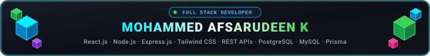
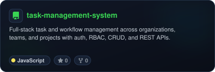
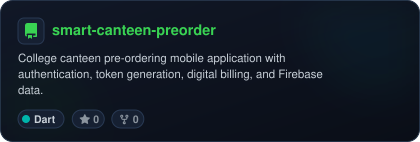
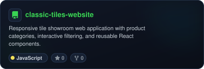
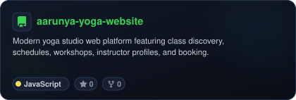
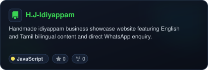
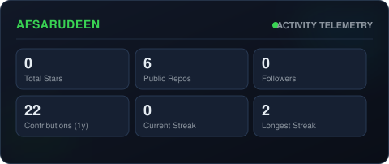

<div align="center">

<!-- HERO 3D BANNER -->


<br><br>

<!-- PORTRAIT - Dot matrix generated by scripts/dotify.py with animated row reveal -->
<picture>
  <source media="(prefers-color-scheme: dark)" srcset="assets/portrait.svg">
  <source media="(prefers-color-scheme: light)" srcset="assets/portrait.svg">
  
</picture>

<br><br>

<!-- ANIMATED TYPING HEADER -->
<a href="https://github.com/afsarudeen">
  
</a>

<br>

<!-- LIVE STATUS CAPSULE -->


<br><br>

<!-- CONNECT & VERIFIED BADGES -->
<a href="https://afsarudeen-portfolio.vercel.app"></a>
<a href="https://linkedin.com/in/mohammed-afsarudeen"></a>
<a href="mailto:afsarudeenma10@gmail.com"></a>
<a href="https://github.com/afsarudeen"></a>


<br><br>


</div>

---

<!-- SECTION 01: ABOUT -->
<p align="center">
  
</p>

```console
$ cat developer_profile.json
```

```json
{
  "name": "Mohammed Afsarudeen K",
  "title": "Full Stack Developer",
  "location": "Tuticorin, Tamil Nadu, India",
  "education": "Bachelor of Computer Applications (BCA) · Sadakathullah Appa College · CGPA 7.56",
  "experience": "Full Stack Web Development Intern · Jaz Infotech (Jul 2026 – Oct 2026, Completed)",
  "core_focus": [
    "Responsive Web Applications",
    "RESTful API Architecture",
    "Authentication & Role-Based Access Control",
    "CRUD Operations & Database Integration",
    "Performance & Component Reusability"
  ],
  "portfolio": "https://afsarudeen-portfolio.vercel.app"
}
```

BCA graduate with completed **Full Stack Web Development internship** experience at **Jaz Infotech** (Tirunelveli). Experienced in building responsive web applications, developing REST APIs, authentication flows, CRUD operations, and integrating relational and NoSQL databases. Passionate about writing clean, maintainable code and delivering reliable client-facing products.

---

<!-- SECTION 02: SKILLS & RADAR -->
<p align="center">
  
</p>

<div align="center">

<!-- TECH ICONS -->


<br><br>

<table>
  <thead>
    <tr align="center">
      <th>Domain</th>
      <th>Technologies &amp; Tools</th>
    </tr>
  </thead>
  <tbody>
    <tr>
      <td><b>Frontend</b></td>
      <td><code>JavaScript (ES6)</code> <code>React.js</code> <code>Tailwind CSS</code> <code>HTML5</code> <code>CSS3</code></td>
    </tr>
    <tr>
      <td><b>Backend &amp; APIs</b></td>
      <td><code>Node.js</code> <code>Express.js</code> <code>REST APIs</code> <code>Laravel (basic)</code></td>
    </tr>
    <tr>
      <td><b>Databases &amp; ORM</b></td>
      <td><code>MySQL</code> <code>PostgreSQL</code> <code>MongoDB (basic)</code> <code>Prisma</code></td>
    </tr>
    <tr>
      <td><b>Workflow &amp; Tooling</b></td>
      <td><code>Git</code> <code>GitHub</code> <code>Postman</code></td>
    </tr>
  </tbody>
</table>

<br>

<!-- RADAR CHARTS (Dark / Light Auto-Switching) -->
<table>
  <tr>
    <td width="50%" align="center" valign="middle">
      <b>Competency Distribution (Skill Radar)</b><br><br>
      <picture>
        <source media="(prefers-color-scheme: dark)" srcset="assets/radar-dark.svg">
        <source media="(prefers-color-scheme: light)" srcset="assets/radar-light.svg">
        
      </picture>
    </td>
    <td width="50%" align="center" valign="middle">
      <b>Live GitHub Language Mix (Byte-Weighted)</b><br><br>
      <picture>
        <source media="(prefers-color-scheme: dark)" srcset="assets/radar-langs-dark.svg">
        <source media="(prefers-color-scheme: light)" srcset="assets/radar-langs-light.svg">
        
      </picture>
    </td>
  </tr>
</table>

</div>

---

<!-- SECTION 03: FEATURED REPOSITORIES -->
<p align="center">
  
</p>

<div align="center">

<table>
  <tr>
    <td width="50%" align="center">
      <a href="https://github.com/afsarudeen/task-management-system">
        <picture>
          <source media="(prefers-color-scheme: dark)" srcset="assets/card-task-management-system-dark.svg">
          <source media="(prefers-color-scheme: light)" srcset="assets/card-task-management-system-light.svg">
          
        </picture>
      </a>
      <br>
      <b><a href="https://github.com/afsarudeen/task-management-system">task-management-system</a></b>
    </td>
    <td width="50%" align="center">
      <a href="https://github.com/afsarudeen/smart-canteen-preorder">
        <picture>
          <source media="(prefers-color-scheme: dark)" srcset="assets/card-smart-canteen-preorder-dark.svg">
          <source media="(prefers-color-scheme: light)" srcset="assets/card-smart-canteen-preorder-light.svg">
          
        </picture>
      </a>
      <br>
      <b><a href="https://github.com/afsarudeen/smart-canteen-preorder">smart-canteen-preorder</a></b>
    </td>
  </tr>
  <tr>
    <td width="50%" align="center">
      <a href="https://github.com/afsarudeen/classic-tiles-website">
        <picture>
          <source media="(prefers-color-scheme: dark)" srcset="assets/card-classic-tiles-website-dark.svg">
          <source media="(prefers-color-scheme: light)" srcset="assets/card-classic-tiles-website-light.svg">
          
        </picture>
      </a>
      <br>
      <b><a href="https://github.com/afsarudeen/classic-tiles-website">classic-tiles-website</a></b>
    </td>
    <td width="50%" align="center">
      <a href="https://github.com/afsarudeen/aarunya-yoga-website">
        <picture>
          <source media="(prefers-color-scheme: dark)" srcset="assets/card-aarunya-yoga-website-dark.svg">
          <source media="(prefers-color-scheme: light)" srcset="assets/card-aarunya-yoga-website-light.svg">
          
        </picture>
      </a>
      <br>
      <b><a href="https://github.com/afsarudeen/aarunya-yoga-website">aarunya-yoga-website</a></b>
    </td>
  </tr>
  <tr>
    <td width="50%" align="center">
      <a href="https://github.com/afsarudeen/H.J-Idiyappam">
        <picture>
          <source media="(prefers-color-scheme: dark)" srcset="assets/card-H.J-Idiyappam-dark.svg">
          <source media="(prefers-color-scheme: light)" srcset="assets/card-H.J-Idiyappam-light.svg">
          
        </picture>
      </a>
      <br>
      <b><a href="https://github.com/afsarudeen/H.J-Idiyappam">H.J-Idiyappam</a></b>
    </td>
    <td width="50%" align="center">
      <!-- Balanced empty column -->
    </td>
  </tr>
</table>

</div>

---

<!-- SECTION 04: KEY PROJECTS -->
<p align="center">
  
</p>

<table>
  <thead>
    <tr>
      <th>Project</th>
      <th>Type</th>
      <th>Tech Stack</th>
      <th>Verified Links</th>
    </tr>
  </thead>
  <tbody>
    <tr>
      <td><b>Amaraalaya Yoga Studio</b></td>
      <td>Client Project</td>
      <td><code>React.js</code> <code>Tailwind CSS</code> <code>Node.js</code> <code>Express.js</code> <code>Prisma</code> <code>PostgreSQL</code></td>
      <td>—</td>
    </tr>
    <tr>
      <td><b>Bella Spot Parlour</b></td>
      <td>Client Project</td>
      <td><code>React.js</code> <code>TypeScript</code> <code>Tailwind CSS</code> <code>Laravel</code> <code>MySQL</code> <code>REST APIs</code></td>
      <td>—</td>
    </tr>
    <tr>
      <td><b>Task Management System</b></td>
      <td>Full-Stack Internship Project</td>
      <td><code>React.js</code> <code>Tailwind CSS</code> <code>Laravel</code> <code>MySQL</code> <code>REST APIs</code></td>
      <td><a href="https://github.com/afsarudeen/task-management-system">GitHub Repository</a></td>
    </tr>
    <tr>
      <td><b>Nila Tiles</b></td>
      <td>Real Client Project</td>
      <td><code>React.js</code> <code>Tailwind CSS</code></td>
      <td><a href="https://nilatiles.in/">Live Website</a></td>
    </tr>
    <tr>
      <td><b>Ram Prabha Builders</b></td>
      <td>Real Client Project</td>
      <td><code>React.js</code> <code>Tailwind CSS</code></td>
      <td>—</td>
    </tr>
    <tr>
      <td><b>Smart Canteen Pre-Order System</b></td>
      <td>College Project</td>
      <td><code>Flutter</code> <code>Firebase</code></td>
      <td><a href="https://github.com/afsarudeen/smart-canteen-preorder">GitHub Repository</a></td>
    </tr>
  </tbody>
</table>

<details>
<summary><b>🔍 View Project Architectural Summaries</b></summary>
<br>

* **Amaraalaya Yoga Studio:** Full-stack yoga studio platform with dynamic website management, backend REST APIs, student CRM, course enrollments, quiz modules, blogs, and administrative management.
* **Bella Spot Parlour:** Responsive beauty parlour web application with services and packages catalogue, booking management, REST API integration, and custom administrative management panel.
* **Task Management System:** Multi-tier workflow system structuring organization, team, project, and task flows with Laravel Sanctum authentication, role-based access control, CRUD operations, and Postman-tested REST APIs.
* **Nila Tiles:** Commercial showroom web application ([nilatiles.in](https://nilatiles.in/)) featuring dynamic product categories, product filtering, mobile UI, and SEO-optimized React components.
* **Ram Prabha Builders:** Construction business enterprise site built with responsive business-oriented layouts, React components, and Tailwind CSS.
* **Smart Canteen Pre-Order System:** Flutter + Firebase college canteen mobile application featuring student authentication, digital order flows, token generation, and real-time database management.

</details>

---

<!-- SECTION 05: EXPERIENCE -->
<p align="center">
  
</p>

### **Full Stack Web Development Intern** — [Jaz Infotech](https://jazinfotech.com/)
*Tirunelveli, Tamil Nadu, India*  
**Duration:** July 2026 – October 2026 *(Internship Completed)*

- **Frontend Engineering:** Developed responsive web applications and client interfaces using **React.js** and **Tailwind CSS**.
- **Backend & REST APIs:** Designed and implemented backend REST APIs with token-based authentication and role-based authorization.
- **Database Architecture:** Performed CRUD operations and schema integration using **MySQL**, **PostgreSQL**, and **Prisma**.
- **API Testing & Quality:** Tested, verified, and documented API endpoints extensively using **Postman**.
- **Collaboration & Version Control:** Collaborated actively in an agile team workflow utilizing **Git** and **GitHub** against real business specifications.

---

<!-- SECTION 06: EDUCATION & CERTIFICATIONS -->
<p align="center">
  
</p>

<table>
  <tr>
    <td width="50%" valign="top">
      <h3>🎓 Education</h3>
      <b>Bachelor of Computer Applications (BCA)</b><br>
      Sadakathullah Appa College, Tirunelveli, Tamil Nadu<br>
      <b>Period:</b> 2023 – 2026<br>
      <b>CGPA:</b> <b>7.56</b>
    </td>
    <td width="50%" valign="top">
      <h3>📜 Certifications</h3>
      <ul>
        <li><b>Full Stack Web Development Internship</b> — Jaz Infotech</li>
        <li><b>NPTEL Soft Skill Development</b></li>
        <li><b>Claude with Google Vertex AI</b></li>
      </ul>
    </td>
  </tr>
</table>

---

<!-- SECTION 07: TELEMETRY & STREAKS -->
<p align="center">
  
</p>

<div align="center">

<!-- SELF-HOSTED 3D STATS CARD -->
<picture>
  <source media="(prefers-color-scheme: dark)" srcset="assets/card-stats-dark.svg">
  <source media="(prefers-color-scheme: light)" srcset="assets/card-stats-light.svg">
  
</picture>

<br><br>

<!-- CONTRIBUTION SNAKE -->
<picture>
  <source media="(prefers-color-scheme: dark)" srcset="https://raw.githubusercontent.com/afsarudeen/afsarudeen/output/snake-dark.svg">
  <source media="(prefers-color-scheme: light)" srcset="https://raw.githubusercontent.com/afsarudeen/afsarudeen/output/snake.svg">
  
</picture>

</div>

---

<!-- SECTION 08: CONNECT -->
<p align="center">
  
</p>

<div align="center">

<a href="https://afsarudeen-portfolio.vercel.app"></a>
<br><br>
<a href="https://linkedin.com/in/mohammed-afsarudeen"></a>
<a href="mailto:afsarudeenma10@gmail.com"></a>
<a href="https://github.com/afsarudeen"></a>

<br><br>

<sub>Designed with 3D-inspired vector aesthetics · Fully automated via GitHub Actions</sub>

</div>
